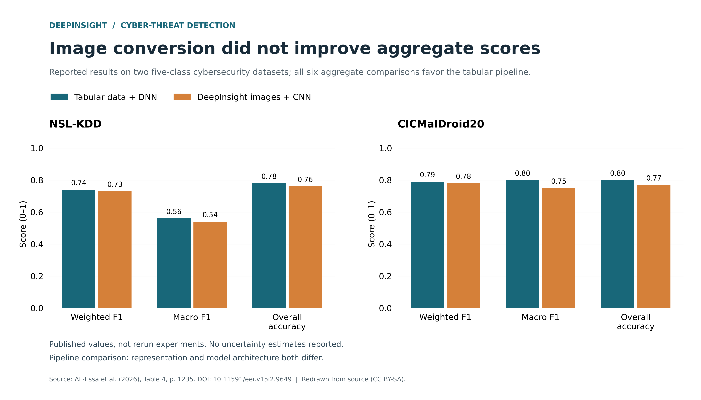
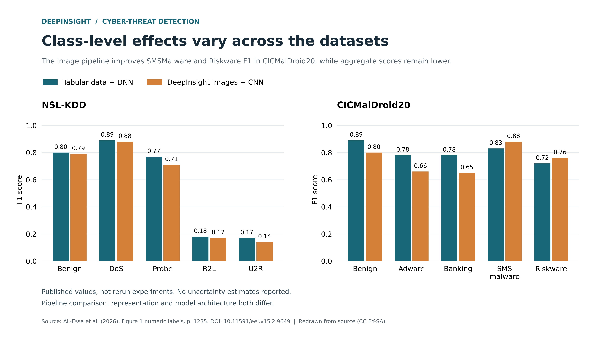

# DeepInsight cyber-threat detection: reproducibility scaffold

Based on AL-Essa, Qatawneh, Turab & Alsarhan (2026), *Challenges in applying DeepInsight for cyber threat detection*. Bulletin of Electrical Engineering and Informatics 15(2), 1231–1238. https://doi.org/10.11591/eei.v15i2.9649

## Status
This is a PDF-derived companion scaffold, not the authors' original software or an independently reproduced experiment. It reproduces visualizations of published rounded results only. No training code, predictions, checkpoints, original environment or raw datasets were supplied. No experiments have been rerun. This initial repository contains the published-result companion; it is not yet a DOI-bearing release.

## Regenerate the figures
From this directory, using Python 3:
```bash
python -m pip install -r requirements-figures.txt
python scripts/plot_results.py
```
Outputs: `figures/Results_Comparison.{png,pdf,svg}` and `figures/Per_Class_F1.{png,pdf,svg}`. The plotting script uses the CSV tables, not hard-coded plot values. PNGs are exported at 300 dpi; PDF/SVG are vector formats.

## Contents
- `data/aggregate_results.csv`: exact Table 4 transcription and derived score differences.
- `data/per_class_results.csv`: exact printed Figure 1 labels (not estimates from bar heights).
- `configs/reported_settings.json`: reported settings; unknown values are null.
- `docs/REPRODUCIBILITY_CHECKLIST.md`: missing materials and inconsistencies to resolve.
- `docs/FIGURE_CAPTIONS.md`: interpretation, provenance and caveats.
- `docs/SOURCE_ARTICLE.cff`: source-article bibliographic metadata, kept outside the root to avoid being mistaken for package metadata.
- `PROVENANCE.json`: source file identity and extraction scope.

## Interpretation
The image pipeline has lower aggregate scores in these two reported comparisons. SMSMalware and Riskware F1 improve in the CICMalDroid20 figure. This is a comparison of complete pipelines (tabular DNN versus DeepInsight + CNN), not a controlled isolation of the image conversion effect. No uncertainty estimates or significance tests are supplied. Do not generalize to all DeepInsight implementations or datasets.

## Moving toward experimental reproducibility
Obtain the original code and artifacts, resolve checklist items, record dataset checksums and split indices, then run preprocessing, conversion, tuning, training and evaluation with explicit configuration and logs. Store newly computed metrics separately from the paper transcription. Do not overwrite the published values or describe them as reproduced.

## Rights
The source paper declares a CC BY-SA license. See its publisher page for exact terms before redistribution. Attribute the authors and identify these charts as redrawn from reported results. No software license has been selected on behalf of the authors; agree on a license before publishing code. Dataset access and redistribution require their own terms. The source PDF and datasets are not bundled.

## Results preview





## Archive status
A Zenodo release is pending confirmation of package creator credits and licensing, and activation of the GitHub–Zenodo integration. The journal DOI above identifies the source article, not this package. No archive DOI has been minted.

## Preparation disclosure
This companion package and plotting script were prepared with ChatGPT assistance from the published PDF. Numeric transcriptions were checked against Table 4 and Figure 1; this does not constitute independent experimental validation.
